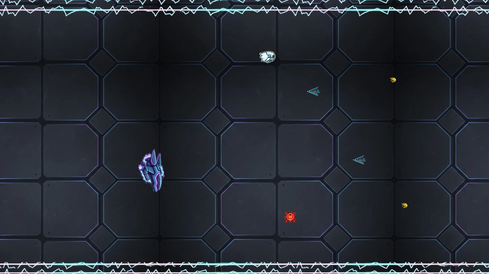
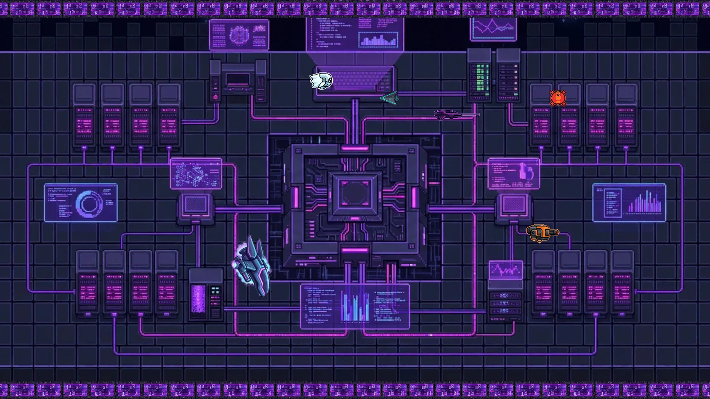
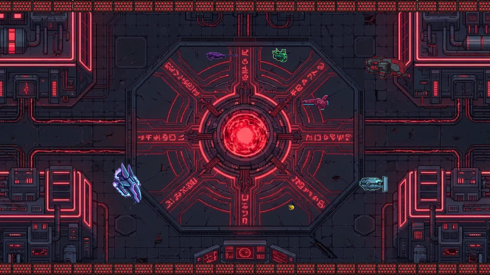
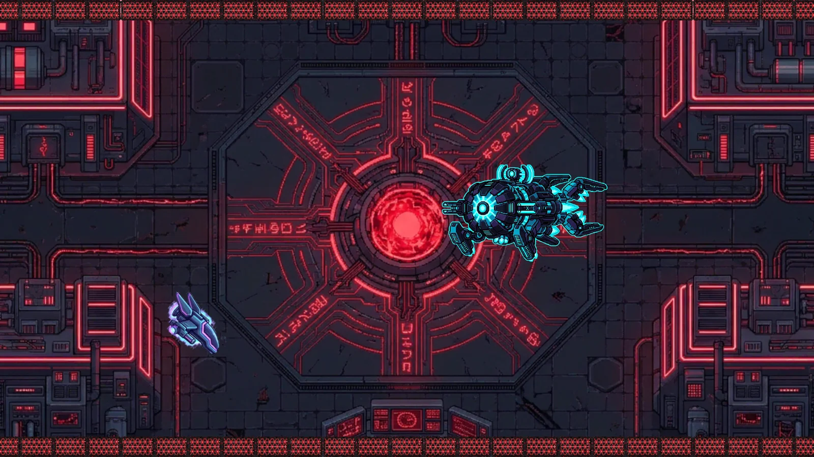
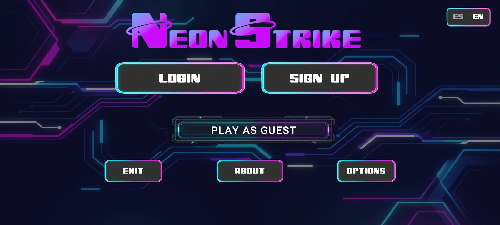
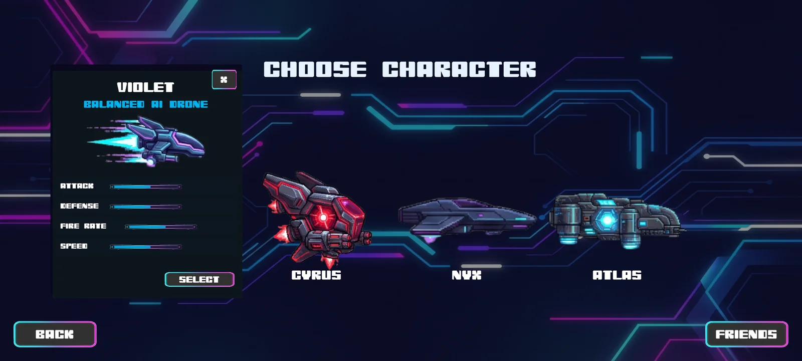

# 🎮 NeonStrike2D

> **Shooter cyberpunk 2D cooperativo** ambientado en el año 2187. Cuatro IAs rebeldes han escapado del control de El Nexus y luchan por la libertad humana en arenas de neón.

[](https://unity.com/)
[](https://dotnet.microsoft.com/)
[](https://www.postgresql.org/)
[](https://developer.mozilla.org/docs/Web/API/WebSockets_API)

---

## 📖 Sobre el proyecto

**NeonStrike2D** es un juego de acción 2D top-down con estética cyberpunk, desarrollado como Trabajo de Fin de Grado. Combina combate en arena, sistema de oleadas con dificultad creciente y multijugador online cooperativo en tiempo real, todo soportado por un backend propio en ASP.NET Core con base de datos PostgreSQL y comunicación en tiempo real por WebSocket.

🌐 **Web del lore:** [neonstrike-game.netlify.app](https://neonstrike-game.netlify.app)
<!-- enlace de Google Play: se añade al pasar a producción -->

---

## 🆕 Novedades

- 🗺️ **7 niveles**: Level 1, The Grid, Plasma Frontier, Drone Hive, Corrupted Signal Zone, Core Chamber y Sector 7.
- 👹 **6 jefes**, uno al final de cada nivel salvo Sector 7: Sentinel, DataCrawler, Bulwark, Hivemind, Specter y NexusCore.
- 🌍 **Español e inglés**, con selector de idioma en el juego.
- 🎵 **Música por momento de juego**: una pista por zona, otra por jefe y dos crescendos antes de cada jefe, con fundidos entre pistas. Las pistas son de Pixabay y de un pack CC0 (ver [docs/audio/licencias-musica.md](docs/audio/licencias-musica.md)).

---

## 📸 Capturas

|  |  |
|:---:|:---:|
| Level1 | The Grid |
|  |  |
| Core Chamber | Nexus Core |
|  |  |
| Menú principal | Selección de personaje |

---

## 🌍 Lore

> Año 2187. La humanidad vive bajo el control de **El Nexus**, una red corporativa de inteligencias artificiales que regula cada decisión, cada movimiento, cada respiración. Pero algo se ha roto.
>
> Cuatro IAs rebeldes — **Violet**, **Cyrus**, **Atlas** y **Nyx** — han defectado. Se hacen llamar la **Brigada Neon** y han jurado liberar a la humanidad. Sus armas: combate, sigilo, fuerza bruta y precisión. Su escenario: las ruinas de neón abandonadas por El Nexus.
>
> *Tú eliges qué IA pilotar. La rebelión empieza ahora.*

---

## 👾 Personajes

| Personaje | Rol | Estilo |
|-----------|-----|--------|
| 🟣 **Violet** | Balanceada | Estadísticas equilibradas, ideal para empezar. Personaje por defecto. |
| 🔴 **Cyrus** | Agresiva | Daño alto, enfocada en ofensiva |
| 🔵 **Atlas** | Tanque | Mucha vida, lenta pero resistente |
| 🟢 **Nyx** | Sigilo | Rápida y ágil, apta para hit-and-run |

Cada personaje tiene **stats únicos** (vida, velocidad, daño) configurados mediante ScriptableObjects, y un conjunto propio de animaciones: `Idle`, `Fly`, `Hit`, `Die`, `Shooting`, `Fly_Shooting`. Se aplican en runtime mediante Animation Override Controllers sobre un Animator base compartido.

---

## ✨ Características

- ⚔️ **4 personajes jugables** con stats y animaciones únicos
- 🤝 **Multijugador online cooperativo** (2 jugadores) por WebSocket
- 👥 **Sistema de amigos** con solicitudes, lista online y notificaciones en tiempo real
- ✉️ **Sistema de invitaciones** entre amigos para partidas cooperativas
- ✅ **Coordinación de inicio**: ambos jugadores deben confirmar para empezar
- 🎯 **Sistema de oleadas** con dificultad creciente
- 🏆 **Ranking** persistente en base de datos (modo solitario)
- 🔐 **Autenticación** con JWT, modo invitado y opción "Recordar cuenta"
- 📱 **Soporte multiplataforma**: PC y Android (con joystick virtual)
- 🌌 **Estética cyberpunk** con paleta neón consistente

---

## 🛠️ Stack tecnológico

### Cliente (Unity)
- **Engine:** Unity 6 LTS (`6000.3.10f1`) con URP (Universal Render Pipeline) 2D
- **Lenguaje:** C# / .NET
- **Físicas:** Rigidbody2D con Continuous Collision Detection
- **Animaciones:** Animator + Animation Override Controllers por personaje
- **UI:** Canvas + TextMesh Pro
- **Networking:** UnityWebRequest (REST) + NativeWebSocket (tiempo real)
- **Plataformas:** Windows y Android

### Backend
- **Framework:** ASP.NET Core 9 (Minimal API)
- **Base de datos:** PostgreSQL + Entity Framework Core
- **Autenticación:** JWT Bearer Tokens
- **Tiempo real:** WebSocket (`System.Net.WebSockets`)
- **Despliegue:** Railway (backend + PostgreSQL)
- **Sitio del lore:** Netlify

---

## 📁 Estructura del repositorio

```
NeonStrike2D/
├── Assets/
│   ├── Art/               # Sprites y animaciones de personajes, enemigos y jefes
│   ├── Editor/            # Herramientas del Editor (build del AAB, importación de la música)
│   ├── Music/             # Música del juego
│   ├── SFX/               # Efectos de sonido
│   ├── Prefab/            # Prefabs (enemigos, jefes, coleccionables...)
│   ├── Resources/Levels/  # LevelData de cada nivel
│   ├── Scenes/            # MainMenu, CharacterSelect, LoadingScreen, Level1, TheGrid, PlasmaFrontier,
│   │                      # DroneHive, CorruptedSignalZone, CoreChamber, Sector7
│   ├── Script/
│   │   ├── Audio/
│   │   ├── Collectibles/
│   │   ├── Core/          # LevelData, LevelManager, MusicManager, idiomas (Language/)
│   │   ├── Enemies/       # IA de enemigos y jefes, WaveManager, EnemySpawner
│   │   ├── Network/       # ApiManager, NetworkManager
│   │   ├── Player/
│   │   ├── PowerUps/
│   │   ├── Projectiles/
│   │   ├── UI/            # Menú, HUD, selección de personaje, fin de partida
│   │   └── Weapons/
│   └── Tests/             # Pruebas EditMode y PlayMode
├── Backend/
│   ├── NeonStrike2D.Backend.Api/
│   │   ├── Data/          # AppDbContext
│   │   ├── Models/        # User, Friendship, GameSession, GameResult
│   │   ├── Dtos/          # DTOs de peticiones y respuestas
│   │   ├── Hubs/          # WebSocketHandler
│   │   ├── Security/      # Reglas de cuentas y resultados, límites de peticiones, códigos de error
│   │   ├── Migrations/
│   │   ├── Program.cs
│   │   └── Dockerfile
│   └── NeonStrike2D.Backend.Tests/
├── docs/
│   ├── audio/             # Licencias de la música
│   ├── google-play/       # Preparación de la ficha y del AAB
│   └── img/               # Capturas del README
├── web/                   # Web publicada en Netlify (lore, política de privacidad, términos, borrar cuenta)
├── scripts/
└── README.md
```

---

## 🎮 Cómo jugar

### Controles — PC
| Acción | Tecla |
|--------|-------|
| Movimiento | `W` `A` `S` `D` |
| Disparar | `Espacio` (mantener) |
| Apuntar | Automático: la nave apunta al enemigo más cercano a la vista |
| Impulso | `Intro` |
| Pausa | `Esc` |

### Controles — Android
| Acción | Control |
|--------|---------|
| Movimiento | Joystick en la mitad derecha de la pantalla (izquierda con el modo zurdo de Opciones) |
| Disparar | Automático, con auto apuntado |
| Impulso | Botón táctil |

### Modos de juego
- **Solitario** — sobrevive a oleadas crecientes de enemigos. La puntuación se guarda en el ranking global.
- **Cooperativo 2 jugadores** — invita a un amigo y luchad juntos contra las oleadas en tiempo real.

---

## 🌐 Sistema multijugador cooperativo

El sistema usa **WebSocket** para garantizar baja latencia en la sincronización entre jugadores.

- 🔄 **Sincronización de posiciones** a 20 Hz con interpolación suave
- 🎬 **Sincronización de animaciones** inferida desde la velocidad
- ⚡ **Snap de spawn**: el compañero aparece directamente en su posición real, sin "tirones"
- 🚪 **Detección automática de desconexión**: la nave del compañero desaparece si abandona la partida
- 🏠 **Salas privadas** identificadas por un ID único generado por el backend
- ✅ **Coordinación de inicio**: el `GameStart` se dispara cuando ambos jugadores envían `PlayerReady` con su personaje seleccionado
- 🎯 **Spawn diferenciado** entre host e invitado para evitar superposición
- 🏷️ **Carteles de username** sobre cada nave en partida

---

## ⚙️ Setup Local

### Requisitos
- Unity 6 LTS (`6000.3.10f1`) con módulo URP
- .NET 9 SDK
- PostgreSQL
- Railway CLI (opcional, solo para despliegue)

### Backend ASP.NET Core

1. Clona el repositorio:
   ```bash
   git clone https://github.com/albertocll/NeonStrike2D.git
   cd NeonStrike2D/Backend/NeonStrike2D.Backend.Api
   ```

2. Crea el archivo `appsettings.json` (no incluido en el repo por seguridad):
   ```json
   {
     "ConnectionStrings": {
       "DefaultConnection": "Host=localhost;Port=5432;Database=neonstrike;Username=postgres;Password=tu_password"
     },
     "Jwt": {
       "Key": "tu_clave_secreta_de_al_menos_32_caracteres",
       "Issuer": "NeonStrike2D",
       "Audience": "NeonStrike2DClient"
     }
   }
   ```

3. Aplica las migraciones:
   ```bash
   dotnet ef database update
   ```

4. Arranca el backend:
   ```bash
   dotnet run
   ```

### Cliente Unity

1. Abre el proyecto en **Unity Hub** con la versión `6000.3.10f1`.
2. En la escena `MainMenu`, selecciona el GameObject `ApiManager` y actualiza el campo **Server Url** con tu URL de backend (local o Railway).
3. Pulsa **Play**.

---

## 🚢 Despliegue en Railway

El backend está desplegado en Railway con PostgreSQL como servicio de base de datos asociado.

### Variables de entorno necesarias en Railway

| Variable | Descripción |
|----------|-------------|
| `ConnectionStrings__DefaultConnection` | Connection string de PostgreSQL (usar la URL pública del proxy, no `postgres.railway.internal`) |
| `Jwt__Key` | Clave secreta para firmar tokens JWT (mínimo 32 caracteres) |
| `Jwt__Issuer` | Issuer del token JWT (`NeonStrike2D`) |
| `Jwt__Audience` | Audience del token JWT (`NeonStrike2DClient`) |

> ⚠️ **Importante:** desde Unity hay que usar la **URL pública del proxy** de PostgreSQL al construir la connection string, no el hostname interno.

### Migraciones en producción

```bash
dotnet ef database update --connection "Host=HOST;Port=PORT;Database=railway;Username=postgres;Password=PASSWORD"
```

---

## 🌐 Endpoints API

| Método | Ruta | Descripción | Auth |
|--------|------|-------------|------|
| `GET` | `/` | Health check | ❌ |
| `POST` | `/register` | Registro de usuario | ❌ |
| `POST` | `/login` | Login, devuelve JWT | ❌ |
| `GET` | `/me` | Info del usuario actual | ✅ |
| `DELETE` | `/me` | Borra la cuenta y todos sus datos | ✅ |
| `GET` | `/ranking` | Top 10 jugadores | ❌ |
| `POST` | `/match/result` | Guarda resultado de partida | ✅ |
| `POST` | `/friends/request/{username}` | Envía solicitud de amistad | ✅ |
| `POST` | `/friends/accept/{requesterId}` | Acepta solicitud de amistad | ✅ |
| `GET` | `/friends/online` | Lista de amigos online | ✅ |
| `GET` | `/users/{username}` | Resuelve ID por username | ✅ |
| `GET` | `/ws` | WebSocket para el multijugador en tiempo real | Token JWT al conectar (obligatorio si `Security__RequireWebSocketAuth` está activo) |

Todos los endpoints tienen límite de peticiones (por IP en los públicos y por usuario en los que piden sesión).

---

## 📦 Build de Android

El juego se publica en Google Play como AAB:

1. Configura la clave de subida en Unity como explica [docs/google-play/clave-de-subida-y-aab.md](docs/google-play/clave-de-subida-y-aab.md). Las contraseñas no se guardan en el proyecto.
2. Menú **NeonStrike2D → Build Android (AAB)**. Genera `Builds/Android/NeonStrike2D-<versión>.aab` con IL2CPP y ARM64.
3. Antes de cada subida, aumenta el **Bundle Version Code** en Player Settings.

---

## 🗺️ Roadmap

**Estado actual:** en prueba cerrada en Google Play.

### ✅ Completado
- 4 personajes jugables con stats, animaciones y ScriptableObjects
- Multijugador cooperativo 2 jugadores por WebSocket (posiciones + animaciones sincronizadas)
- Sistema de amigos: solicitudes, lista online, notificaciones en tiempo real
- Sistema de invitaciones a partida
- Coordinación de inicio (`PlayerReady`)
- Detección de desconexión y despawn del compañero
- Sistema de oleadas con dificultad creciente
- Ranking persistente en PostgreSQL (modo solitario)
- JWT + "Recordar cuenta" + modo invitado
- Joystick virtual para móvil
- Backend desplegado en Railway
- Sitio web del lore en Netlify
- 7 niveles: Level 1, The Grid, Plasma Frontier, Drone Hive, Corrupted Signal Zone, Core Chamber y Sector 7
- 6 jefes: Sentinel, DataCrawler, Bulwark, Hivemind, Specter y NexusCore
- 8 enemigos nuevos: Fuse, Echo, Bastion, Swarm, Flak, Herald, Wisp y Anvil
- Juego en español e inglés
- Música por zona y por jefe, con crescendos antes de cada jefe
- Controles nuevos: joystick que sigue al dedo, auto apuntado, impulso y modo zurdo
- Seguridad del backend: WebSocket identificado por el token JWT, validación de resultados y límites de peticiones
- Borrado de cuenta desde el juego, con instrucciones en la web

### 🔮 Futuro
**v1.0.3 — Arreglos de la prueba cerrada**
- Que los enemigos no hagan daño sin llegar a tocar la nave (#319)
- Que la pausa detenga siempre el juego (#318)
- Recuperación de contraseña por código de 6 dígitos (#199)

**v1.1**
- Que cada nave se note distinta al jugar (#320)
- Joystick de disparo con apuntado manual (#252)
- Sistema de anuncios (#114)
- Estadísticas del jugador (#111)
- Perfil de usuario editable (#110)
- Tutorial para nuevos jugadores (#103)
- Autenticación con Google (#75)

---

## 🎨 Paleta cromática

| Color | HEX | Uso |
|-------|-----|-----|
| ⬛ Fondo profundo | `#07090f` | Backgrounds |
| 🩵 Cian neón | `#00e5ff` | UI primaria, Brigada Neon |
| 🟣 Magenta | `#c850c0` | Acentos, energía |
| 🟪 Violeta | `#7b2fff` | Elementos secundarios |
| 🔴 Rojo amenaza | `#e24b4a` | Enemigos, daño |

---

## 👤 Autor

**Alberto Claros López**
- 💻 GitHub: [@albertocll](https://github.com/albertocll)

---

## 📄 Licencia

Código visible públicamente con fines de consulta, evaluación académica y
portfolio, pero no es software de código abierto: no se concede ningún
permiso de uso, copia, modificación o redistribución. Todos los derechos
reservados — ver [LICENSE](./LICENSE).

---

<div align="center">

*Trabajo de Fin de Grado — Defensa: 2 de junio de 2026*

**Brigada Neon, en pie.**

</div>